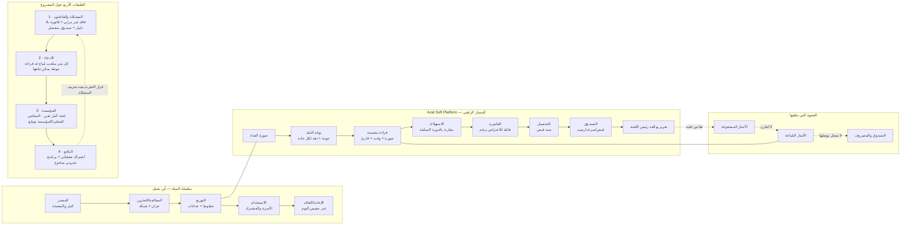

# مخطط المشروع وفق محاضرات YP8 — الأسبوع الأول
### Azal Soft Platform — سجل تشغيل الآبار: من العداد إلى الفاتورة إلى الصندوق

**ما هذا الملف:** خريطة عمل واحدة تُطابق **صناديق المحاضرات الأربع** (الاثنين 2 → الخميس 5 نوفمبر) مع مشروعنا. كل صندوق مكتوب هنا **بالاسم الذي ورد في الشريحة**، وتحته إجابتنا وحالتها. التفصيل الكامل يبقى في `docs/water_challenge_brief_ar.md`؛ وهذا الملف هو **المخطط**: ماذا نضع في أي إطار، وما الناقص، وما يُسلَّم.

**قاعدة الحالة:** ✅ موجود في الكود أو محسوم · 🟡 مكتوب ويحتاج رقمًا أو اسمًا من الميدان · ⛔ فجوة يجب إغلاقها قبل التسليم.

**المهلة:** الجمعة 6 نوفمبر، 12:00 — أربعة إطارات تُصدَّر في ملف من صفحتين، وهو **30٪** من درجة أفضل 12، ويصبح ملفك في متتبّع البرنامج.

---

## 0 · بنية المحاضرات كما يجب أن تُقرأ

| اليوم | الطبقة | صندوق المساء (المخرج) | ما يُطلب منك فعلاً |
|---|---|---|---|
| الاثنين | 1 · أين نقع | مشكلة + ثلاثة فاعلين | جملة مشكلة بلا أسماء منتجات، ومستوى نطاق صريح |
| الثلاثاء | 2 · ادعاؤنا | بطاقة ادعاء من 6 صناديق | رقم واحد بوحدة، ودرجة دليل، واختبار واحد |
| الأربعاء | 3 · المؤسسات | من يقرر + أول طلب | اسم جهة تقول «نعم»، وطلب من 6 أسطر بلا مال |
| الخميس | 4 · السوق والدافع | من يدفع + أول عميل + 100 كلمة | آلية دفع حقيقية، ورقم سوق من الأسفل لا من الأعلى |

**الخيط الناظم:** مشكلة حقيقية → ادعاء قابل للقياس بدليل مصنَّف → مؤسسة تستطيع أن تقول «نعم» → دافع يدفع مقابل نتيجة محددة → تجربة تُنتج قرارًا. أي طبقة بلا الطبقة التي قبلها لا تُقيَّم.

---

## 1 · المخطط الكبير

**أين نقع على سلسلة المياه:** المجموعة الثالثة في الشرائح — *Water losses & digital infrastructure* — وتحديدًا عند الوصلة **التوزيع → الاستخدام** (العداد والفاتورة والتحصيل)، لا عند المعالجة.

**الشكل المختصر الذي يُرسم في Miro (إطار واحد):**
`مشكلة (فاقد غير مرئي) → ادعاء (قراءة موثوقة تُقفل الفجوة) → مؤسسة (لجنة البئر تقول نعم) → دافع (اشتراك من رسوم التحصيل) → تجربة (4 دورات × 10 آبار) → قرار (توسيع أو تعديل)`.

---

## 2 · الطبقات الأربع: من صندوق الشريحة إلى حالتنا

| الطبقة | سؤال المساء | صندوق الشريحة | إجابتنا في سطر | الحالة |
|---|---|---|---|---|
| **1** | ما المشكلة؟ ومن يقرر ويدفع؟ | problem sentence + three actors + level + dialogue | عشرة آبار تُدار بالورق: القراءة تُنسخ، والفاقد لا يُرى، والفاتورة لا تُعترض إلا بالكلام | ✅ جملة · 🟡 أسماء |
| **2** | ما الادعاء وكم يُغيّر وبأي دليل؟ | بطاقة 6 صناديق | كل متر مكعب مُباع يحمل قراءة موثقة (صورة + وقت + قارئ + ثقة) قبل أن يصبح فاتورة | ✅ الادعاء · ⛔ خط الأساس |
| **3** | من يقرر؟ وما أول طلب؟ | 6 أنواع مؤسسات + بوابات الالتزام + أول طلب | لجنة البئر تقول «نعم» لأربع دورات على بئرها؛ والمجلس المحلي يفتح الوصول | ✅ الهيكل · 🟡 الاسم |
| **4** | من يدفع وبكم؟ | لوحة الدافع + السوق من الأسفل + أول عميل | لجنة البئر تدفع اشتراكًا من رسوم التحصيل بعد إثبات الوفر؛ ومانح يدفع مقابل القياس الآن | ✅ المنطق · 🟡 السعر |

---

## 3 · الطبقة 1 — إطار «أين نقع» (الاثنين)

| الحقل (كما في الشريحة) | إجابتنا |
|---|---|
| **Domain** | Digital — تشغيل شبكات الآبار: العدادات، القراءات، الدورات، الفواتير، الصندوق، التقارير |
| **Stage** | منتج عامل في إطلاق تجريبي محدود (لا فكرة على ورق): 10 آبار / 60 مشتركًا / 100٪ من عدادات النطاق |
| **Initiative type** | منتج رقمي + نموذج تشغيل خدمي (Service & operating model) — لا جهاز ولا محطة |
| **Water focus** | **Primary** — المياه هي موضوع الخدمة نفسها، لا مجالًا مجاورًا |
| **Primary dialogue** | **(a) Water for People** — الخدمة والفاتورة العادلة وإمكانية الاعتراض على رقم |
| **Secondary dialogue** | **(b) Water for Prosperity** — المشتركون يستخدمون الماء في معيشتهم، ووضوح الكلفة يحمي استمرار الخدمة · *(بديل مشروع: (f) Investments for Water — لأن مخرجنا هو الشفافية المالية للبئر؛ لكن لا نطرحه كأساس، فطلب التمويل ليس تحديًا مائيًا)* |
| **Level today** | **2 · Community** — بئر ولجنة ومشتركون |
| **Level in 3 years** | **3 · Policy** — إذا تبّنت مؤسسة المياه المحلية تقرير القراءة الموثقة كصيغة تقاريرها الشهرية · كيف؟ عبر تجربة موقّعة على 10 آبار يعتمدها المشرف الإقليمي |
| **Problem sentence (قبل/بعد)** | **الآن:** قراءة العداد تُكتب على ورق ثم تُنسخ لاحقًا، والفاقد بين المضخوخ والمُباع لا يراه أحد، والصندوق منفصل عن الأرقام. **بعد:** سلسلة واحدة (قراءة موثقة → استهلاك → فاتورة → تحصيل → صندوق) يمكن للجنة والمشترك والمدير العام أن يتحققوا منها بالرقم نفسه |
| **Who suffers** | الأسرة المشتركة (فاتورة بلا دليل) · قارئ العداد (خطأ ليس منه) · رئيس اللجنة (عجز يُكتشف في نهاية الشهر) |
| **Who decides** | لجنة البئر في التشغيل · المجلس المحلي/المؤسسة المحلية في التمويل والتوسع |
| **Who pays** | المشتركون عبر الرسوم (تشغيليًا) · مانع/برنامج مياه (التجربة) |
| **Where the system fails** | عند الوصلة بين المُباع والصندوق: لا مقارنة بين المضخوخ والمُباع، ولا أثر يربط القراءة بالدليل |
| **Where we intervene** | لحظة القراءة (بوابة الثقة) ولحظة إقفال الدورة (الفاتورة والصندوق) |
| **What we must find out** | كم من الفجوة «تجاري» (قراءة ناقصة/غير محصّلة) وكم «فيزيائي» (تسرّب)؟ وهل تتحرك اللجنة على الرقم؟ |

**جدول الفاعلين الثلاثة (يُرسم كثلاث دوائر):**

| | من هو | ما يريده | ما يخسره اليوم | ما نطلبه منه |
|---|---|---|---|---|
| **المستفيد** | الأسرة المشتركة (60 مشتركًا) | ماء مستمر وفاتورة مفهومة | يدفع رقمًا لا يستطيع الاعتراض عليه بدليل | لا شيء — يُقاس أثرها |
| **صاحب القرار** | رئيس لجنة البئر | يعرف عجزه قبل نهاية الشهر ويوقف النزاع | وقت ومصداقية أمام المشتركين | إذن البدء + مشرف واحد |
| **الدافع** | اللجنة (رسوم) + مانح (تجربة) | وفر ملموس وتقرير يمكن توقيعه | فاقد وصيانة غير مرئيين | دفع مقابل نتيجة محددة |

**خطأ تتجنبه الشريحة:** «مشكلتنا أن الناس لا يستخدمون تطبيقنا». المشكلة موجودة قبل منتجك — إن اختفى منتجك غدًا، تبقى المشكلة قائمة. اكتبها هكذا.

---

## 4 · الطبقة 2 — بطاقة الادعاء (الثلاثاء)

### 4.1 الصناديق الستة

| # | الصندوق | إجابتنا |
|---|---|---|
| 1 | **What it does** | يحوّل صورة عداد إلى قراءة معتمدة لا تصل إلى الفاتورة إلا بعد اجتياز بوابة ثقة، ثم يربطها بالاستهلاك والحساب |
| 2 | **By how much** (رقم واحد + وحدة) | **الفاقد غير المرئي: من «غير معروف» إلى رقم محدَّد بالنسبة المئوية لكل بئر بعد 4 دورات** — i.e. فرق المضخوخ/المُباع معروف لأول مرة · الهدف التشغيلي المرافق: **≥ 85٪ قبول آلي** و**≥ 95٪ تغطية** للستين عدادًا |
| 3 | **How it works** (جملة واحدة) | صورة → فحص جودة قبل التعرّف → تقطيع سبع خانات → ثقة لكل خانة وتطبيع الأرقام → قرار (قبول/إعادة تصوير/مراجعة بشرية) → استهلاك → فاتورة → سند → صندوق |
| 4 | **Evidence & tier** | **Tier 1 — self-reported:** تطبيق عامل، دورة كاملة مغلقة، خط OCR ببوابة جودة، تقارير قابلة للتوقيع. **ما يرفعها إلى Tier 2:** 240 قراءة موثقة على 60 عدادًا في 4 دورات مع خطأ مرجعي محسوب |
| 5 | **The question we could not answer** | هل الفجوة بين المضخوخ والمُباع **تجارية** (قراءة/تحصيل) أم **فيزيائية** (تسرّب)؟ ومن يملك بيانات الضخ أصلًا؟ |
| 6 | **The one test** | 10 آبار × 60 عدادًا × 4 دورات: نقيس زمن القراءة، نسبة القبول الآلي، الخطأ بعد المراجعة، ونسبة التحصيل — مقابل خط أساس ورقي من الدورة نفسها |

**المقياس المختار من الخمسة:** *Losses avoided (m³/day أو نقاط NRW)* + *cost to deliver (USD/m³)* كمقياس مساند. **لماذا لا زمن القراءة؟** الزمن يخدم المشرف لا اللجنة؛ الرقم الذي يحرّك القرار هو «كم مترًا لم يكن accounted for».

### 4.2 العائلة التقنية وما يجب أن تُثبته

| العائلة | ما يجب إثباته | موقعنا |
|---|---|---|
| Service & operating models | أن النموذج التشغيلي يعمل بيد قارئ عداد واحد | ✅ هذا موقعنا |
| Digital & decision support | أن القرار يتغيّر بالرقم (لا أن الشاشة جميلة) | ✅ مساند |
| Sensors & metering | أن القياس نفسه دقيق | ⛔ لا نملكه: نعتمد عدادات قائمة |

**قاعدة الشريحة:** «الادعاء ليس ما يفعله منتجك، بل ما يُغيّره في الميدان». لا نكتب «تطبيق لتعرّف الأرقام» — التعرّف الضوئي سلعة جاهزة.

### 4.3 الأسئلة الأربعة التي يحكم بها المشرف

| السؤال | جوابنا |
|---|---|
| ما الآلية؟ | القراءة غير الموثقة تفقد قيمتها المحاسبية؛ فتُنقل نقطة التحقق من آخر الشهر إلى لحظة القراءة |
| هل تصمد في الظروف الحقيقية؟ | نعم إن صمدت الصورة: شمس مباشرة، غبار، شاشة متعرجة — لذلك بوابة الجودة قبل التعرّف، والرفض قرار لا خطأ |
| أفضل من ماذا؟ | من الدفتر: لا خط أساس ولا أثر ولا مقارنة بين دورتين |
| ما الاختبار الذي يصمد أمام النقد؟ | الحقيقة المرجعية قراءتان يدويتان مستقلتان قبل التعرّف الآلي — نقيس خطأ الورق قبل خطأ الآلة |

**حدود الاستدلال تُقال صراحة:** 60 عدادًا × 4 دورات تكفي لكشف فرق واضح (≈3 نقاط مئوية)، ولا تكفي لادعاء دقة 0.1٪.

---

## 5 · الطبقة 3 — المؤسسات وأول طلب (الأربعاء)

### 5.1 الأنواع الستة في نطاقنا

| النوع | من هو عندنا | ما يملكه | يقول «نعم» لأول تجربة؟ | كيف يشتري |
|---|---|---|---|---|
| وزارة/جهة وطنية | وزارة المياه والبيئة | السياسة والخطة | توجيهًا فقط — لا تدير بئرًا | موازنة برامج، دورة طويلة |
| منظّم | الهيئة العامة للموارد المائية وجهاز المواصفات | الترخيص والمعايير | مشروطًا (اعتماد طريقة القراءة) | لا يشتري خدمة |
| مرفق/مشغّل | المؤسسة المحلية للمياه (المحافظة) | الشبكة والبيانات | نعم إن كان البئر في نطاقها — أبطأ مسار | عقد خدمة/مناقصة |
| بلدية/مالك موقع | **المجلس المحلي (المديرية)** | الوصول الميداني | **نعم — الأولوية** | ميزانية محلية صغيرة |
| مشغّل صناعي | صاحب بئر/مزرعة/معمل | قراره وماله | **نعم — الأسرع** | شراء مباشر تحت سقف |
| شريك تنموي | مانح/منظمة مياه (SFD/UNICEF-WASH) | التمويل ودرء المخاطر | نعم — يدفع مقابل القياس | برنامج تجريبي مدفوع |

**قاعدة الشريحة:** من الستة تحتاج **جوابين لا ستة**. «نعم» تأتي من مالك الموقع (الوصول) والمشغّل (القرار والدفع). و«لا» تستطيع أن تأتي من المنظّم ومن المرفق — لذلك تُترك مرحلتان للتوسع.

**اختبار المشرف:** أي جهة من الستة تستطيع أن تقول **«لا»** لتجربتك؟ اكتب اسمها، لا صفتها.

*🟡 ما ينقص:* اسم رئيس لجنة البئر الأولى، واسم مدير المجلس المحلي/المؤسسة، ورقم سقف الشراء المباشر.

### 5.2 بوابات الالتزام الخمس

`Pledge → Plan → Programme → Route → Signature`

| البوابة | أين نحن | الشرط للعبور |
|---|---|---|
| Pledge | التزام وطني بالمياه وكفاءة الاستخدام + شروط المانحين في التقارير | ربط الرقم بمؤشر التزام مكتوب |
| Plan | خطة المديرية/المحافظة لخفض الفاقد | أن نُدرَج كـ«أداة قياس» لا كـ«مشروع مستقل» |
| Programme | برنامج مياه قائم له ميزانية وموقع | أن نكون بندًا داخل البرنامج |
| Route | مسار شراء: تجربة مدفوعة أو شراء مباشر تحت سقف | معرفة السقف والمدة |
| Signature | توقيع لجنة البئر (البدء) والمجلس (التوسع) | **اسم واحد، مكان واحد، تاريخ واحد** |

### 5.3 التجربة = قرار مؤسسي، لا عرض تقني

| العنصر الخمسة | صياغتنا |
|---|---|
| القرار المطلوب | «هل نعتمد سجل القراءة الرقمي أساسًا للفاتورة في هذا البئر؟» |
| الموقع وخط الأساس | البئر الأولى + دورة ورقية كاملة مسجّلة قبل البدء |
| الوصول والموافقات | خطاب من اللجنة + إذن المجلس المحلي + جهة بيانات الضخ |
| المقياس والطريقة | 4 مؤشرات، حقيقة مرجعية بقراءتين مستقلتين، 4 دورات |
| القرار التالي | إن تحقق: إدخال الآبار التسعة + عرض على المؤسسة المحلية |

**ثلاثة قتلة للتجارب (تُفحص قبل العرض):** بلا إذن مكتوب · بلا خط أساس · بلا قاعدة قرار مسبقة («ماذا يعني النجاح؟»).

### 5.4 أول طلب — 6 أسطر (جاهز للنسخ)

> 1. **الشريك والموقع:** لجنة بئر «______» في مديرية «______» — 6 مشتركين بعدادات قائمة.
> 2. **المدة:** أربع دورات قراءة شهرية، تبدأ في «______/11/2026».
> 3. **ما تقدّمه اللجنة:** إذن الوصول، مشرف واحد للتدريب، والسجل الورقي للدورة السابقة (خط الأساس)، ورقم الضخ الشهري.
> 4. **ما نقدّمه:** تشغيل الدورة كاملة على النظام، تدريب قارئ العداد (40 دقيقة)، وتقرير تدقيق من صفحتين يوقّعه رئيس اللجنة.
> 5. **ما يقيسه الطرفان:** زمن القراءة، نسبة القراءات الموثقة، الفرق بين المُباع والمضخوخ، ونسبة التحصيل — بالطريقة نفسها ولنفس الفترة.
> 6. **ما يحدث بعد ذلك:** اجتماع واحد في نهاية الدورة الرابعة: إمّا إدخال الآبار التسعة، أو تعديل طريقة القياس، أو إيقاف التجربة.

**محظوران في هذا الطلب:** لا نطلب مالًا · لا نَعِد بنتيجة قبل القياس («نوفّر 30٪» ممنوعة؛ الصحيح: «نقيس الفاقد ونعرف إن كان قابلًا للتخفيض»).

---

## 6 · الطبقة 4 — من يدفع (الخميس)

### 6.1 لوحة الدافع

| خانة | إجابتنا |
|---|---|
| المستفيد | الأسرة المشتركة (60) |
| صاحب القرار | رئيس لجنة البئر (تشغيل) · المجلس المحلي/المؤسسة (توسع) |
| **الدافع** | **اللجنة** من رسوم التحصيل — تشغيليًا · **مانح/برنامج مياه** — للتجربة |
| الآلية (من الست) | **Tariff/اشتراك تشغيلي** + **Budget line/بند في برنامج** — كلاهما تحت **3Ts: Tariffs + Transfers** |
| علامة أنه يدفع فعلًا | يُدرج الاشتراك في ميزانية البئر السنوية ويُسدَّد من التحصيل، لا من جيب رئيس اللجنة |
| السعر | 150 دولارًا/بئر/سنة [افتراض للتحقق] — يُسوَّغ بثلاث قيم مقيسة: فاقد مكتشف، حسم نزاع، وضوح صندوق |

**الآليات الست في الشرائح:** tariff · budget line · corporate · donor/DFI · pay-as-you-go · PPP. **نستخدم اثنتين فقط**، وأي إضافة تحتاج دافعًا مستقلًا (مثلًا شركة تشغيل آبار خاص تشتري لعدة آبار = corporate).

### 6.2 اختبارات السوق المدفوع الأربعة

| الاختبار | جوابنا | الحالة |
|---|---|---|
| يوجد دافع يملك مالًا؟ | نعم: رسوم التحصيل في صندوق البئر | 🟡 يحتاج رقمًا |
| توجد آلية يدفع بها؟ | اشتراك سنوي من الصندوق، أو بند في برنامج مانح | ✅ |
| يُقاس على ما يدفع مقابله؟ | نعم: فاقد مكتشف، زمن، تحصيل | ✅ |
| يوجد سعر معلن؟ | 150 دولارًا/بئر/سنة | 🟡 افتراض |

### 6.3 السوق من الأسفل — أربعة أرقام فقط

`السوق = عدد العملاء × الوحدات/سنة × السعر × الحصة`

| الرقم | قيمتنا | المصدر |
|---|---|---|
| العملاء (آبار في السوق الأول: المديرية) | **100 بئر** (افتراض يحتاج عدًّا ميدانيًا) | 🟡 |
| الوحدات/سنة | 1 اشتراك/بئر/سنة | — |
| السعر | 150 دولارًا | 🟡 افتراض |
| الحصة في 3 سنوات | 10٪ = 10 آبار | — |
| **السوق المدفوع القابل للوصول** | **10 × 150 = 1,500 دولار/سنة** | محسوب |

**الحكم الذي يجب أن يُقال:** بنطاق 10 آبار و60 مشتركًا **لا يوجد سوق بعد — يوجد دليل**. عشرة آبار × 150 دولارًا = 1,500 دولار لا تغطي راتب شهر. لذلك المرحلة الحالية تُموَّل كـ**برنامج تجريبي مدفوع يولّد دليلًا**، لا كاشتراك تجاري. من يبيعها كـ«سوق» يخسر مصداقيته أمام اللجنة.

### 6.4 أول عميل — بالمعايير الأربعة

| المعيار | تقييم البئر الأولى |
|---|---|
| **الألم** | نزاع قراءة أو عجز صندوق موثّق | 🟡 يُختار بالبيانات |
| **الميزانية** | صندوق البئر يتحمّل 150 دولارًا | 🟡 |
| **السلطة** | رئيس اللجنة يوقّع بلا انتظار | 🟡 |
| **السرعة** | البدء في أسبوعين | ✅ |

**قالب التسمية (لا تُقبل الصفات):** بئر «____» — رقم 1 من العشرة — مديرية «____» — لجنة برئاسة «____» — __ مشتركًا — عدادات «____» — الحاجة المعلنة: «____» — القرار المتوقع: «__/11/2026». **اسم واحد، مكان واحد، رقم واحد، تاريخ واحد.**

### 6.5 المئة كلمة

**العربية:**
> في عشرة آبار وستين مشتركًا تُقرأ العدادات بالورق، وتُنسخ الأرقام لاحقًا، ويُدار صندوق البئر بعيدًا عنها: فاقد لا يراه أحد، وفاتورة لا يمكن الاعتراض عليها بدليل، وعجز يُكتشف في نهاية الشهر. يحوّل Azal Soft Platform هذه السلسلة إلى سجل واحد: صورة العداد تُقرأ آليًا، وبوابة ثقة ترفض الرقم المشكوك فيه قبل الفاتورة، ثم الاستهلاك، ثم الفاتورة، ثم التحصيل، ثم الصندوق. نشغّله الآن على الآبار العشرة والمشتركين الستين، ونقيس أربعة أرقام: زمن القراءة، نسبة القراءات الموثقة، الفرق بين المضخوخ والمُباع، ونسبة التحصيل. نطلب أربع دورات وأربعين دقيقة لتدريب قارئ العداد، لنُثبت الرقم قبل أن نطلبه من أحد.

**English (100 words):**
> Across ten wells and sixty subscribers, meters are read on paper and the numbers are copied later, while the well's fund is kept apart from them. The result is losses nobody can see, a bill a household cannot contest with evidence, and a shortfall discovered at month end. Azal Soft Platform turns that chain into one record: a meter photo read automatically, a trust gate that blocks any doubtful number before it reaches a bill, then consumption, invoice, collection and fund. We are running it on all ten wells and all sixty subscribers, measuring four numbers: reading time, share of verified readings, the gap between pumped and billed water, and collection rate. We ask for four cycles and forty minutes to train one reader, to prove the number before asking more.

**قاعدة الصياغة:** الأربع طبقات بالترتيب، بلا صفات، «نتوقع/سنختبر» لا «نوفّر».

---

## 7 · خطة الأيام (2–6 نوفمبر)

| اليوم | ما يُنجز | ما يُرسل في الشات | ما يُجمع من الميدان |
|---|---|---|---|
| **الاثنين** | إطار 1 كاملًا: جملة المشكلة + الفاعلون الثلاثة + المستوى + الحواران | الإطار كصورة أو 8 أسطر | جدول الآبار العشرة (اسم، قرية، مشتركون، عداد، لجنة، حالة الصندوق) |
| **الثلاثاء** | بطاقة الادعاء 6 صناديق + المقياس + درجة الدليل | البطاقة كما هي | خط أساس ورقي لدورة واحدة + رقم الضخ |
| **الأربعاء** | جدول المؤسسات + التجربة كقرار + **أول طلب** | مسوّدة الطلب (6 أسطر) | اسم رئيس اللجنة + موافقة الوصول |
| **الخميس** | لوحة الدافع + 4 أرقام + أول عميل + 100 كلمة | النسخة النهائية 100 كلمة | سعر/سقف الشراء، ورقم صندوق البئر |
| **الجمعة قبل 12:00** | تصدير صفحتين: 4 إطارات + 100 كلمة | الملف النهائي | — |

---

## 8 · الفجوات (تُغلق قبل الجمعة)

| # | البيان الناقص | من يملكه | كيف يُجمع | الحالة |
|---|---|---|---|---|
| 1 | عدد الآبار الفعلي في المديرية | المجلس المحلي/المؤسسة | سؤال واحد | ⛔ |
| 2 | الأمتار المضخوخة شهريًا لكل بئر | مشغّل المضخة/اللجنة | سجل الديزل أو ساعات التشغيل | ⛔ |
| 3 | الأمتار المُباعة والتحصيل (آخر دورة) | اللجنة | سجل ورقي | ⛔ |
| 4 | تكلفة المتر المكعب (ديزل+عامل+صيانة ÷ مُباع) | اللجنة | معادلة من تقرير الطاقة | 🟡 |
| 5 | اسم بئر أول + رئيس لجنتها | الميدان | زيارة | 🟡 |
| 6 | سقف الشراء المباشر | المجلس/المؤسسة | سؤال إداري | 🟡 |
| 7 | موافقة مكتوبة على الوصول | اللجنة + المجلس | خطاب | ⛔ |

---

## 9 · قائمة التسليم

**الشكل:** صفحتان كحد أقصى · 4 إطارات مرقّمة بالطبقات · الـ100 كلمة في آخر الصفحة الثانية · كل رقم بعلامة مصدره (`[معطى]` / `[محسوب]` / `[افتراض]`).

**ما يُنقص الدرجة (من الشرائح):**
1. مشكلة مكتوبة كأنها غياب منتجك.
2. ادعاء بلا رقم أو بلا وحدة.
3. «Dolphin evidence»: دليل من اختصاص آخر يُسند ادعاءك.
4. طلب مال أو وعد بنتيجة قبل القياس.
5. مؤسسة بصفة عامة («المؤسسات»، «المزارعون») بدل اسم.
6. سوق محسوب من الأعلى (سوق عالمي × 1٪).
7. صفات في الـ100 كلمة («ثوري»، «ذكي»، «فعّال»).
8. بلا خط أساس وبلا قاعدة قرار في التجربة.

**ما نُزيله من النسخ الحالية عند التصدير:** جداول الكود التفصيلية (تبقى في الملحق داخل المستودع)، وشرح خوارزمية الثقة (يبقى سطرًا واحدًا)، وأي وعد بـ«خفض الفاقد 30٪» قبل القياس.

---

## 10 · أين يقع هذا الملف في المستودع

- `docs/water_challenge_brief_ar.md` — التفصيل الكامل للطبقات الأربع (المرجع).
- `docs/water_challenge_brief_en.md` — نسخة التسليم الإنجليزية + مقترح المشروع + ملاحق الكود.
- `docs/yp8_project_map_ar.md` — **هذا الملف**: المخطط المطابق للشرائح + الفجوات + خطة الأيام.
- `tool/deploy_web.sh` · `docs/web_hosting.md` — نشر التطبيق الذي تُقاس عليه التجربة.
